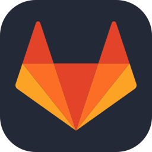

# 👋 Hi, I'm sk

| Tools & Platforms | Programming Languages |
| --- | --- |
| `Github`  | `C++`     |       
| `Gitlab`  | `Python`  |
| `VSCode ` | `Lua`  |
| `Interactive Disassembler (IDA)`  |

## My Projects
**Helios** \
a macOS executor with 100% sUNC and 99% UNC | [website](https://helios.best/) \
\
*and other stuff that i cant be bothered adding (fr)*
